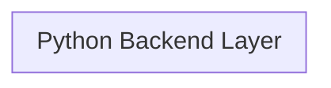

# Codebase Blueprint & Structural Graph

<!-- AUTO:BEGIN — regenerated by sync-architecture.sh. Do not edit. -->
## 1. High-Level Design (HLD) Topology


## 2. Current Target Directory Tree
```text
.
 assets
  logo
 docs
  master
 gsclaude
 installer
 tests
 ui
  pages
```
<!-- AUTO:END -->

## 3. Low-Level Design (LLD) & SOLID Class Schemas
> **Note on the auto-graph above:** `sync-architecture.sh` detects HTTP route decorators
> to build its topology. GO Omni Pro is an offline desktop app with no routes, so the
> Python subgraph is empty by design. The real structure is documented here.

### Layering

```
converter_core · archive_core · rename_organizer_core · ocr_core · organizer_core
  ↑ pure domain logic — no Tk imports, callable headless, raises ConversionError
app_state · about_profile · automation_core                (persistence + config)
  ↑
ui_theme            design tokens (palettes, spacing, radii, fonts) — single source of truth
  ↑
ui/kit.py           widget factory; the ONLY module that names a colour or builds a widget
  ↑
ui/pages/*.py       one module per screen, each exposing build(app)
  ↑
app.py              shell, state wiring, and every event handler
```

**Dependency rule:** arrows point one way only. A core module must never import `ui.*`
or `app`; a page must never import another page. `app.py` owns the handlers, pages own
the layout.

### Primary Interfaces

| Contract | Signature | Used by |
|---|---|---|
| Conversion job | `process_batch(BatchConfig, log: LogFn, progress: ProgressFn) -> list[Path]` | Convert page |
| PDF operation | `process_pdf_tool(PdfToolConfig, log, progress) -> list[Path]` | PDF Tools page |
| Archive | `create_archive / extract_archive / batch_compress / read_archive` | Archive page |
| Rename / organise | `plan_*() -> OperationPlan` → `apply_plan() -> (moves, manifest)` → `undo_last()` | Rename page |
| Page contract | `ui.pages.<name>.build(app) -> None` | `app._build_shell` |
| Failure signal | `ConversionError` — the single exception type every core raises | all pages |

`LogFn = Callable[[str], None]`, `ProgressFn = Callable[[int, int], None]`. Long
operations run on a worker thread and marshal back via `app.after(0, ...)`.

### Design tokens (Dependency Inversion for styling)

Pages ask for a *variant* (`"primary"`, `"muted"`, `"card"`), never a hex value.
`ui_theme` resolves variants per palette; `UIKit.retheme()` repaints every widget it
built from a registry, so theme/contrast/compact/scale switching needs no page changes.

The glass look is real gradient + precomputed composite colours: `surface` is literally
white-at-8% over `gradient_mid`. Tk cannot blur, so no `backdrop-filter` equivalent
exists — see `GradientBackdrop`.

### CustomTkinter widgets deliberately not used

Three CTk widgets call `update_idletasks()` from inside `_draw()`, which flushes the
`<Configure>` events that re-trigger that draw — an unbounded loop that hangs the app on
any resize or theme change. Replaced in `ui/kit.py`:

| Avoided | Replacement | Reason |
|---|---|---|
| `CTkScrollableFrame` | `ScrollArea` | canvas + ttk scrollbar, no redraw feedback path |
| `CTkTextbox` | `LogBox` | embeds the same scrollbar |
| `CTkOptionMenu` | themed `ttk.Combobox` | redraw cascade; also gives native `state()` |

`ttk.Treeview` / `tk.Listbox` / `ttk.Scrollbar` remain because CTk has no equivalent.
All are themed from the same palette.

### Backwards-compatibility shims

`app.py` holds ~50 handler call sites written against ttk. Rather than rewrite them,
`ui/kit.py` preserves the API surface:

- `ProgressBar.__setitem__("value", 0..100)` — ttk's convention, now eased/animated.
- `TtkStateMixin.state(["disabled"])` on Button/Entry/CheckBox/Radio — used throughout
  `_update_mode_controls` and `_update_pdf_tool_controls`.
- `ButtonBar.add()` returns the widget, matching the old `FlowButtonBar`.

This is why the migration changed layout code only and left business logic untouched.

### Cross-platform boundaries

| Concern | Resolution |
|---|---|
| State dir | `%APPDATA%` / `~/Library/Application Support` / `~/.config`, with one-time migration from `~/.gokul_omni_convert_lite` |
| LibreOffice, Tesseract | PATH first, then per-OS install locations (`_platform_*_paths()`) |
| Dark mode | Windows registry · macOS `defaults read` · light default elsewhere |
| Drag & drop | `tkinterdnd2` optional; every drop zone degrades to click-to-browse |

### Invariants worth not breaking

1. Core modules stay Tk-free and headless-testable.
2. Never call `grab_set()` — an app-modal grab freezes the root loop on macOS.
3. Never call `update_idletasks()` from a `<Configure>` handler or a redraw.
4. Every animation checks *Reduced motion* and jumps to its final value when set.
5. Rename/organise must write an undo manifest before it is considered done.
6. All four palettes must clear WCAG AA 4.5:1 for body text.
